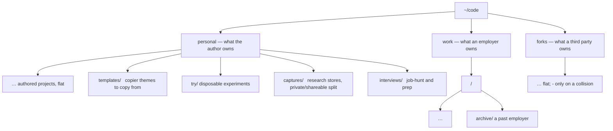

# LAYOUT.md

The cross-machine directory standard: which top-level trees exist, what lives
in each, who owns them, and how the fleet migrates to them. Settled with the
author 2026-09-15; re-settled 2026-10-18 to an ownership-based top level.

## Policy

**The principle: who owns it.** The top level sorts by ownership, not purpose.
`personal` is what the author owns, `work` is what an employer owns, `forks` is
what a third party owns. Reference material pulled in from other owners is a
kind of fork until it earns its own tree (see `resources`, deferred, below).
Purpose — a template, an experiment, a captured research note — is a second
level inside `personal`, never a sibling at the top.

**Scope.** `~/code` and the capture/state trees. Nothing else is covered
yet; the standard is designed to adjust over time rather than to be right
once. `~/docs` and `~/tools` are deliberately out — their fates belong to
the root-docs-topology and skill-trust topic tasks in `TASKS.md`.

**Dotfiles is a top-level repo, not a member of `~/code`.** The chezmoi
checkout lives at `~/.local/share/chezmoi` (deployed to `~/dotfiles`). What
matters is that it *exists* on a machine, not that it stays current: its
presence is automated (a fresh box clones it), and it is never pulled by a
sync or upgrade pass — updating is deliberate. Its storage layout and how
changes are made to it are an open refactor, queued in `TASKS.md`.

**Sameness.** The same tree on two machines has the same structure. The layout
is designed once and both machines migrate to it; neither machine's current
tree is canonical. Queue prose and docs cite the standard by name instead of
pasting absolute paths — the 2026-09-15 merge broke three claims on exactly
that.

**The taxonomy.** Three top-level trees under `~/code/`.

| Tree | Holds | Second level |
|---|---|---|
| `personal` | Everything the author owns | flat authored projects, plus `templates/`, `try/`, `captures/`, `interviews/` |
| `work` | Employer-owned clones | one dir per employer; `<employer>/archive/` for a past employer |
| `forks` | Third-party clones — not owned, not an employer | flat; `<owner>-<name>` only on a name collision |

The author's own projects sit flat under `personal/`. Four named subdirs carry
projects that are the author's but of a distinct kind:

- `templates/` — the author's copier themes, copied *from*.
- `try/` — disposable experiments; nothing here is durable. The name is a
  convention, not self-describing, so `try/README.md` explains what it is, to
  a human and a machine.
- `captures/` — research capture stores (e.g. `llocallabs-capture`), not
  repos. Carries an internal private/shareable split (`spec.md` § Data): one
  careless copy must never put private career notes beside shareable
  research.
- `interviews/` — interview prep. The former top-level `archive` type folded
  in here; a cold personal project is either kept under its home here or
  deleted outright.

`work` is namespaced per employer so a personal machine spanning jobs never
confuses one employer's repos with another's. An employer may nest by
org/project; an employer's org structure is not ours to flatten.

**`resources`, deferred.** There was a `resources/` candidate — a tree for
things other projects reference rather than run: template collections, tool
clones used as reference (e.g. `gitignore`, `gitattributes`, `git-ignore`).
Today its members are all third-party clones, so they live in `forks/`; the
concept is parked, not gone. If reference material ever mixes personal and
third-party entries so that neither `personal/` nor `forks/` is its right
home, `resources/` returns as a top level of **symlinks** into those trees —
a repo always lives in its ownership home, and `resources` becomes an index
over it, never a second physical copy. Re-open then.

Promotion between types is a move plus a gita re-registration, never a copy —
repos are managed by git, not duplicated.

**Membership.** `machines.yml` — committed, plain data — declares which repos
a machine gets, and gita consumes it. Personal repo names are committed; work
repos are named only in a machine-local overlay, because employer-identifying
strings must not be committed (`spec.md` § Data). Membership lists cite paths
relative to the type dir, not bare names — names collide across orgs.

**New repos.** The type is declared at clone time. No default pile, no
post-hoc sorting pass.

**Ownership and enforcement.** An Ansible topic owns the type directories —
system state, per the layering rule in `AGENTS.md` — and gita owns the repo
clones inside them. A `roles/guards` check reports drift (a repo outside its
declared type, an ad-hoc directory) at provision time and fixes nothing
itself, matching the guards' never-auto-repair rule. Self-healing relocation
is the designed evolution; it ships only when classification is trusted,
because a wrong class that moves files is worse than drift.

**Exceptions.** A directory wanted on one machine only, with its state still
backed up to config, is a declared exception — design deferred, tracked in
`TASKS.md`.

## The plan

Ordered; each phase has its own done-condition. Rollback throughout is the
same: moves are renames with a gita re-registration, nothing is deleted, so
any phase reverses by moving back.

1. **Inventory both machines.** Records every divergent tree with its
   destination type. The Linux box is inventoried as of 2026-10-18 (≈47
   repos); the Mac inventory is still queued.
2. **Write `machines.yml` and the overlay schema.** Committed map for personal
   sets; machine-local overlay for work names. Done when the parent playbook
   slurps the map like a `topic.yml`, per the settled bundle design.
3. **The topic creates the type directories.** Owned by the gita topic once
   built; empty types are cheap, so all three and the personal subdirs are
   created. Done when a fresh machine gets the full skeleton from one run.
4. **Migrate this machine.** Move the `projects/<category>/…` tree into the
   three types (the per-repo mapping is recorded in `TASKS.md`); gita
   re-registers each. `personal/dotfiles` is a redundant second clone of the
   chezmoi checkout and is resolved, not migrated. Done when `~/code` matches
   the taxonomy and every repo still fetches.
5. **Migrate the other machine.** `projects/personal/*` flattens into the
   right types; `try/` is already conformant. Done when the two machines'
   `~/code` trees are structurally identical for the shared types.
6. **Switch the citations.** Queue and docs stop carrying absolute paths and
   cite the standard; the drift guard is added under `roles/guards/`. Done
   when `tests/backlog` and the guard both pass and a planted drifted repo
   is reported, not moved.

## What this is not

Not a backup policy (state backup is the deferred exceptions item and the
backup-design task), not a repo-hosting decision (remotes are untouched), and
not permanent — adjust the taxonomy by editing this file, not by letting a
machine drift.